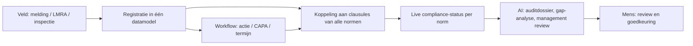

# 01 — Productstrategie, Product Vision, ICP & Personas

## 1. Product vision

**Visie (5 jaar):** IMS Nexus AI is het operationele systeem waarmee organisaties hun managementsystemen *runnen* in plaats van *documenteren*: elke melding, actie, audit en beslissing wordt één keer vastgelegd en telt automatisch mee voor alle relevante normen, wettelijke verplichtingen en managementrapportages.

**Missie (nu):** QHSE-managers in het mid-market 50% minder tijd laten besteden aan administratie en auditvoorbereiding, en de werkvloer laten bijdragen met meldingen die minder dan 60 seconden kosten.

**Productprincipes**

1. *Eén keer registreren, overal gebruiken* — één incident telt voor ISO 45001 §10.2, ISO 14001 §10.2 (bij milieu-impact) en VCA-registratie.
2. *Werkvloer eerst* — melden moet sneller zijn dan een WhatsApp-bericht.
3. *AI doet het voorwerk, mens beslist* — elke AI-output is een voorstel met bron.
4. *Configureren, niet programmeren* — formulieren, checklists en workflows aanpasbaar door de QHSE-manager.
5. *Audit-ready als eindtoestand* — elk scherm kan worden gelezen als bewijs voor een auditor.

## 2. Probleem / oplossing

### Exact probleem

| Probleem | Wie ervaart het | Huidige oplossing | Kosten van het probleem |
|---|---|---|---|
| Documenten, registers en acties verspreid over SharePoint, Excel, e-mail en losse apps | QHSE-manager | Excel-registers, mappenstructuur | 1–3 dagen/maand zoekwerk en bijhouden |
| Dubbele registratie per norm (9001, 14001, 45001, VCA) | QHSE-manager, kwaliteitscoördinator | Aparte handboeken of één handboek met kruisverwijzingen | 20–40% overlap in werk |
| Auditvoorbereiding kost weken; bewijs moet worden verzameld | QHSE-manager, directie | Consultant inhuren, all-hands vlak voor audit | € 5–25k/jaar consultancy + 5–15 werkdagen intern |
| Meldingen uit het veld blijven achter (onder-rapportage) | Werkvoorbereiders, uitvoerders, monteurs | Papieren formulieren, WhatsApp-foto's | Gemiste leerkansen, VCA-/ISO-afwijkingen |
| CAPA's verlopen zonder opvolging | Leidinggevenden | Excel-actielijst | Major non-conformities bij audit |
| Managementreview is handwerk | Directie, QHSE | PowerPoint uit Excel | 2–4 dagen per review |
| Wet- en regelgeving bijhouden | QHSE | Abonnementen/adviseurs | Compliance-risico, boetes |

### Oplossing (kern)

## 3. ICP-analyse

### Kandidaat-ICP's vergeleken

| ICP | Omvang NL (indicatief) | Pijn | Betaalbereidheid | Bereikbaarheid | Concurrentie | Score |
|---|---|---|---|---|---|---|
| **A. Bouw/installatie/infra/onderhoud 50–500 FTE met VCA + ISO 9001 (+14001/45001)** | ~3.000–5.000 bedrijven | Zeer hoog (veldwerk, VCA, tenders/CO2-prestatieladder) | Hoog (€ 5–30k) | Hoog (VCA-/ISO-netwerken, branche-organisaties) | Midden | **★★★★★** |
| B. Productie/maakindustrie 100–1.000 FTE (9001/14001/45001) | ~2.000–3.000 | Hoog | Hoog | Midden | Hoog (ERP-QMS, Ideagen, Zenya) | ★★★★ |
| C. Uitzend/detachering technisch personeel (VCU) | ~500–1.000 | Hoog | Midden | Midden | Laag | ★★★ |
| D. Zorg/onderwijs (kwaliteitskaders, ISO/HKZ) | groot | Midden | Laag–midden | Midden | Hoog (Zenya domineert) | ★★ |
| E. Enterprise (> 2.000 FTE, multi-land) | ~400 | Hoog | Zeer hoog | Laag (lange cycli) | Zeer hoog (Enablon, Cority, Intelex, Sphera) | ★★ (later) |
| F. MKB < 50 FTE met ISO 9001 | ~10.000+ | Midden | Laag (€ 1–3k) | Hoog | Hoog (goedkope tools, Excel) | ★★ (self-serve later) |
| G. ISO-adviesbureaus (als gebruiker voor hun klanten) | ~300–600 | Hoog | Midden | Hoog | Laag | ★★★★ (kanaal) |

**Conclusie:** primaire ICP = **A**, secundaire ICP = **B**, kanaal = **G**. E pas vanaf fase 6. F alleen via self-serve-tier zonder sales.

### ICP A — firmografie

- 50–500 FTE, € 10–150 mln omzet.
- Sectoren: bouw, installatietechniek (E/W), infra, industriële service/onderhoud, tank/terminal-service, schoonmaak/facilitair industrieel, transport/logistiek met VCA.
- Certificaten: VCA*/VCA**/VCA-P, ISO 9001; vaak 14001, CO2-Prestatieladder, ISO 45001 groeiend.
- 1–3 FTE QHSE; > 60% medewerkers in het veld.
- Huidige tooling: SharePoint/Excel + losse inspectie-app of verouderd KAM-systeem.
- Trigger-events: nieuwe certificering (45001), grote tender-eis, nieuwe QHSE-manager, ernstig incident, falende audit, overname.

## 4. Personas

| Persona | Rol | Doelen | Frustraties | Wat IMS Nexus moet leveren | Koopinvloed |
|---|---|---|---|---|---|
| **Sanne — QHSE-manager** | Eigenaar IMS | Audit-ready, grip, minder handwerk | Excel-chaos, achterlopende acties, dubbel werk per norm | Eén register, live status per clausule, AI-auditdossier | **Champion / gebruiker** |
| **Mark — Directeur/DGA** | Eindverantwoordelijk | Certificaten behouden, tenders winnen, geen incidenten | Kosten consultants, verrassingen bij audit | Dashboard, management review in één klik | **Economische koper** |
| **Ahmed — Uitvoerder/projectleider** | Veld-leidinggevende | Werk door laten gaan, veilig werken | Formulieren, dubbele invoer | 60-seconden-melding, LMRA/toolbox op telefoon | Gebruiker / beïnvloeder |
| **Kees — Monteur** | Medewerker veld | Snel melden zonder gedoe | Papier, geen terugkoppeling | Foto + spraak → melding, offline | Gebruiker (gratis seat) |
| **Lisa — Interne auditor/kwaliteitscoördinator** | Audits uitvoeren | Efficiënt auditen, bevindingen opvolgen | Checklist in Word, rapport handmatig | Mobiele checklist, bevinding → CAPA | Gebruiker |
| **Jeroen — IT-/privacy-verantwoordelijke** | Toetser | Veiligheid, AVG, SSO | Shadow-IT, onduidelijke sub-processors | SSO, DPA, EU-hosting, audit log | **Veto** |
| **Petra — Externe ISO-consultant** | Adviseur van 10–40 klanten | Efficiënt meerdere klanten bedienen | Per klant ander systeem | Multi-tenant partnerportaal, templates | **Kanaal / prescriber** |

## 5. Differentiators vs. commodity

| Functie | Commodity / differentiator | Toelichting | Strategie |
|---|---|---|---|
| Documentbeheer met versies | Commodity | Iedereen heeft het | Goed genoeg, M365-integratie |
| Actie-/CAPA-beheer | Commodity | Standaard | Snel en simpel |
| Incidentmelding mobiel | Commodity (maar UX verschilt sterk) | SafetyCulture e.a. zijn sterk | Win op snelheid: foto + spraak + AI-classificatie |
| Auditchecklists | Commodity | Standaard | Templates per norm/sector |
| **Eén registratie → meerdere normen (cross-mapping)** | **Differentiator** | Weinig mid-market tools doen dit goed | Kern van datamodel |
| **AI-gap-analyse op eigen documenten** | **Differentiator (tijdelijk, 18–36 mnd)** | Snel te kopiëren in basisvorm, moeilijk goed te doen | Kwaliteit via normstructuur + bronverwijzing + sectorcontent |
| **AI-auditdossier per clausule met bewijs** | **Differentiator** | Vereist het geïntegreerde datamodel → moeilijk te kopiëren door point solutions | Kernbelofte |
| **AI-management review (ISO §9.3) uit live data** | **Differentiator** | Idem | MVP should-have |
| VCA-specifieke content (LMRA, toolbox, VCA-checklist) | **Lokale differentiator** | Internationale spelers hebben dit niet | Content-moat in NL/BE |
| Partnerportaal voor adviseurs | **Kanaal-differentiator** | Zelden goed opgelost | Fase 3–4 |
| Workflowdesigner | Commodity in enterprise, complex | Duur te bouwen | Configuratie i.p.v. designer tot fase 5 |
| Permits/PTW, assets | Niche-commodity | Specialistische tools bestaan | Later of via integratie |

## 6. Hoe voorkom je dat het product te breed wordt?

1. **Eén "north star metric":** *aantal clausules per klant met actueel bewijs* (audit-readiness) — elke feature moet deze of veldadoptie verhogen.
2. **Module-entreecriterium:** een nieuwe module wordt pas gebouwd als ≥ 3 betalende klanten erom vragen én ≥ 1 deal erop is verloren of gewonnen.
3. **Platformcomponenten eerst, modules later:** generieke bouwstenen (formulierbouwer, register, workflow-statusmachine, koppeling aan clausules) maken nieuwe "modules" goedkoop als configuratie (bijv. TRA/JSA, toolbox = formulier + register + workflow).
4. **"Niet bouwen"-lijst** per fase in het PRD, door de founder ondertekend.
5. **Integreren in plaats van bouwen** voor LMS (training), HR (medewerkers), asset-management, BI.
