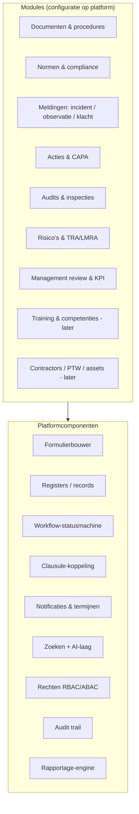
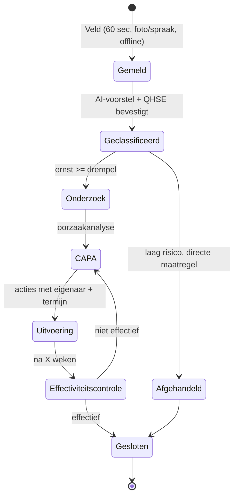

# 03 — Functioneel productontwerp & UX-strategie

## 1. Productarchitectuur: platform + modules

Het product bestaat uit **generieke platformcomponenten** waarop **modules als configuratie** worden gebouwd. Dat voorkomt dat elke module een apart mini-product wordt.



## 2. Moduleoverzicht en prioritering

Prioriteit: **M** = MVP must-have, **S** = MVP should-have / fase 3, **L** = later (fase 4–6), **I** = via integratie, **N** = niet bouwen.

| Module | Kernfunctionaliteit | Prio | Platformcomponenten | Opmerking |
|---|---|---|---|---|
| Dashboard | Rolgebaseerd: mijn acties, open meldingen, compliance-score per norm, verlopen termijnen | **M** | P9, P6 | Drie standaarddashboards (QHSE, directie, leidinggevende) |
| Organisatiebeheer | Tenant, juridische entiteiten, afdelingen | **M** | P7 | Hiërarchie max. 4 niveaus in MVP |
| Locaties / sites / projecten | Vestigingen én tijdelijke projectlocaties (bouw) | **M** | P2 | Project als locatietype — cruciaal voor ICP A |
| Gebruikers | Uitnodigen, SSO (Entra ID), veld-gebruikers zonder e-mail (pincode/QR) | **M** | P7 | Veld-login zonder e-mail is een adoptiekiller als het ontbreekt |
| Rollen & rechten | Vaste rollen + scope (site/afdeling) | **M** | P7 | ABAC-uitbreiding fase 4 |
| Documentmanagement | Versies, goedkeuringsflow, review-termijnen, leesbevestiging | **M** | P2, P3, P5 | Opslaan in eigen storage; SharePoint-koppeling fase 3 |
| Procedures & policies | Documenttypes met verplichte metadata | **M** | idem | Geen aparte module, documenttype |
| ISO-clausules / normkader | ISO 9001/14001/45001 (HS-structuur), VCA; clausule ↔ document ↔ bewijs | **M** | P4 | Geen normtekst zonder licentie |
| Compliance-registers | Wet- en regelgeving, vergunningen, eisen belanghebbenden | **S** | P2, P4 | Content via partner |
| Acties | Eigenaar, termijn, status, herinneringen, bewijs | **M** | P3, P5 | Eén actie-object voor alle bronnen |
| CAPA | Oorzaakanalyse (5×waarom, Ishikawa), correctie, corrigerende maatregel, effectiviteitscontrole | **M** | P3 | AI-suggesties voor oorzaken en maatregelen |
| Audits | Auditprogramma, planning, checklist per clausule, bevindingen, rapport | **M** | P1, P3, P4 | Intern; extern auditrapport uploaden |
| Inspecties | Mobiele checklists (werkplek, materieel, VCA) | **M** | P1 | Template-bibliotheek |
| Incidenten | Melding, classificatie (ongeval, bijna-ongeval, milieu, kwaliteit), onderzoek, Arbeidsinspectie-meldplicht | **M** | P1, P3 | Gezondheidsdata afgeschermd |
| Observaties | Onveilige situatie/handeling, positieve observatie | **M** | P1 | Zelfde flow als incident, lichter |
| Risicoanalyses | Risicoregister (Fine & Kinney / matrix 5×5), beheersmaatregelen | **S** | P2, P4 | RI&E-koppeling NL |
| TRA / JSA | Taakrisicoanalyse per project/taak | **S** | P1 | Formulier + register |
| LMRA | Mobiele last-minute risicoanalyse | **M** | P1 | Typisch VCA, hoge veldfrequentie |
| Toolboxen | Toolbox-meeting registratie, aanwezigheid (QR) | **S** | P1, P2 | VCA-eis |
| Training | Registratie certificaten/opleidingen, verloopdata | **L** | P2, P5 | Geen LMS bouwen → integratie |
| Competenties | Functie-eisen ↔ certificaten | **L** | P2 | Let op AI Act (geen AI-beoordeling van personen) |
| Contractors | Onderaannemers, documenten, VCA-status | **L** | P2 | Portaal fase 5 |
| Permits / PTW | Werkvergunningen, isolaties | **L / I** | P3 | Specialistisch; evt. partner |
| Assets | Materieel, keuringen | **L / I** | P2 | Koppeling met asset-systemen |
| Management review | §9.3 (ISO 9001/14001/45001) input-items automatisch, verslag, besluiten → acties | **S** | P9, P6 | Sterke AI-use-case |
| KPI's | LTIFR, TRIR, meldingsfrequentie, actie-doorlooptijd, auditscore | **M** (basis) | P9 | Deterministisch berekend |
| Rapportages | Export PDF/Excel, geplande rapporten | **M** (basis) | P9 | Power BI-connector fase 4 |
| Workflows | Vaste configureerbare statusflows | **M** (config) | P3 | Visuele designer = **L** |
| Notificaties | E-mail, push, Teams (fase 3), digest | **M** | P5 | Digest voorkomt notificatiemoeheid |
| AI-assistent | Zie [04](04-ai-architectuur.md) | **M** (gap/auditdossier), **S** (rest) | P6 | — |

## 3. Kernworkflows

### 3.1 Melding → CAPA → effectiviteit



Functionele eisen (selectie):

| ID | Eis | Prio |
|---|---|---|
| FR-INC-01 | Melden in ≤ 4 schermtikken; foto, locatie (GPS/projectkeuze), vrije tekst of spraak. | M |
| FR-INC-02 | Offline melden; synchronisatie bij verbinding, conflictvrije append-only. | M |
| FR-INC-03 | Anoniem melden configureerbaar per tenant. | M |
| FR-INC-04 | AI stelt categorie, ernst, betrokken normclausules en mogelijke wettelijke meldplicht voor; mens bevestigt. | M |
| FR-INC-05 | Medische/gezondheidsgegevens in apart, extra afgeschermd veld (alleen rol "Incidentonderzoeker/HR"). | M |
| FR-INC-06 | Melder krijgt terugkoppeling bij afhandeling (adoptie). | M |
| FR-CAPA-01 | CAPA bevat: correctie, oorzaak (methode-keuze), corrigerende maatregelen, effectiviteitscontrole met datum. | M |
| FR-CAPA-02 | CAPA kan niet sluiten zonder effectiviteitsbeoordeling (configureerbaar). | M |

### 3.2 Audit

1. Auditprogramma (jaarplanning, risicogebaseerd) → 2. Audit aanmaken met scope (normen, clausules, sites) → 3. AI genereert concept-checklist + bewijsoverzicht per clausule → 4. Auditor voert uit (mobiel/desktop) → 5. Bevindingen (major/minor/observatie/OFI) → 6. Automatisch CAPA voor NC's → 7. Rapport (PDF) → 8. Opvolging.

### 3.3 Auditdossier / audit-readiness

Per clausule: status (afgedekt / gedeeltelijk / gap), gekoppelde documenten, records (bewijs) van de afgelopen 12 maanden, open acties, laatste interne audit. Score per norm = deterministische berekening; AI levert alleen de *toelichting* en *suggesties*.

## 4. Rollen (MVP)

| Rol | Rechten (samengevat) | Licentie |
|---|---|---|
| Tenant-beheerder | Alles incl. configuratie, gebruikers | Volledig |
| QHSE-manager | Alle modules lezen/schrijven, workflow-configuratie | Volledig |
| Leidinggevende | Eigen scope (site/afdeling/project): meldingen behandelen, acties toewijzen | Volledig |
| Auditor | Audits uitvoeren, bevindingen | Volledig |
| Medewerker (veld) | Melden, LMRA, toolbox-aanwezigheid, eigen acties | **Gratis** |
| Lezer / directie | Dashboards, rapporten | Volledig of "lezer"-tarief |
| Externe auditor / adviseur | Tijdelijk, read-only of scoped | Gratis tijdelijk / partner |
| Incidentonderzoeker (gevoelig) | Toegang tot gezondheidsvelden | Volledig + extra autorisatie |

## 5. UX-strategie

### Principes vertaald naar ontwerpbeslissingen

| Principe | Ontwerpbeslissing |
|---|---|
| Weinig administratieve last | Slimme defaults (locatie, project, datum), AI-vooringevulde velden, "één scherm"-meldingen, bulkacties |
| Mobile first waar nuttig | Mobiel: melden, LMRA, inspectie, toolbox, mijn acties. Desktop: configuratie, analyse, audits plannen, management review |
| Duidelijke workflows | Altijd zichtbaar: "wat is de volgende stap, wie is aan zet, wanneer" |
| Configureerbaar zonder code | Formulierbouwer met drag & drop, statusflows uit templates, velden verplicht/optioneel per tenant |
| Dashboards per rol | Startscherm afhankelijk van rol; widgets in fase 4 aanpasbaar |
| Sterke zoekfunctie | Globale zoekbalk (Cmd/Ctrl-K): records, documenten, clausules; hybride (tekst + semantisch) met filters |
| AI geïntegreerd maar niet dominant | AI verschijnt **in context** (knop "Analyseer", "Stel CAPA voor", "Genereer auditdossier"), niet als dominante chat. Chat bestaat als zijpaneel. Alle AI-output gemarkeerd + bronnen |

### Informatiearchitectuur (navigatie)

```
Home (rol-dashboard)
├─ Melden (+)                ← altijd prominente actieknop
├─ Mijn taken
├─ Meldingen & incidenten
├─ Acties & CAPA
├─ Audits & inspecties
├─ Risico's (TRA, LMRA, register)
├─ Documenten
├─ Normen & compliance       ← clausulematrix, audit-readiness
├─ Rapportages & management review
└─ Instellingen (beheer)
```

### UX-kwaliteitseisen (meetbaar)

| Metric | Doel |
|---|---|
| Tijd voor veldmelding (mediaan) | < 60 seconden |
| Tijd tot eerste waarde na onboarding (eerste gap-analyse) | < 1 dag |
| Weekly active kerngebruikers | > 60% |
| Meldingen per 100 veldmedewerkers per maand | > 10 (benchmark te valideren) |
| SUS-score | > 75 |
| Toegankelijkheid | WCAG 2.2 AA (relevant voor overheids-/semipublieke klanten en de European Accessibility Act) |
| Talen | NL, EN in MVP; DE, FR fase 5; veld-UI ook in PL, TR, RO, PT (arbeidsmigranten in bouw/logistiek — onderschatte eis) |
