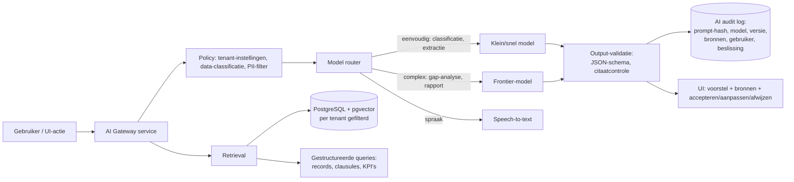

# 04 — AI-strategie & AI-architectuur

## 1. Uitgangspunt

AI voegt waarde toe waar **veel ongestructureerde tekst** moet worden **gekoppeld aan een gestructureerd normkader**, en waar QHSE-professionals nu **schrijfwerk** doen. AI voegt géén waarde toe (en creëert risico) waar beslissingen **deterministisch, juridisch toetsbaar of persoonsgericht** moeten zijn.

## 2. Use-case-evaluatie

Score: waarde (1–5), haalbaarheid nu (1–5), risico (L/M/H), prioriteit.

| Use-case | Waarde | Haalbaar | Risico | Rol AI | Prio |
|---|---|---|---|---|---|
| **Gap-analyse documenten vs. normstructuur** | 5 | 4 | M | Adviserend, met bronverwijzing per clausule | **MVP** |
| **Auditdossier per clausule genereren** (bewijs ophalen + samenvatten) | 5 | 4 | M | Adviserend; bewijs = echte records (deterministisch opgehaald) | **MVP** |
| **Melding classificeren** (type, ernst, clausules, meldplicht-signaal) | 4 | 5 | M | Voorstel; mens bevestigt | **MVP** |
| **Spraak → melding** (transcriptie + structurering, meertalig) | 4 | 5 | L | Invulhulp | **MVP** |
| **Documentimport & clausule-mapping** (onboarding) | 5 | 4 | M | Voorstel; bulk-bevestiging | **MVP** |
| CAPA-suggesties (oorzaken, maatregelen) | 4 | 4 | M | Suggesties, nooit automatisch | S |
| Management review-concept (§9.3) | 4 | 4 | M | Concepttekst uit deterministische KPI's | S |
| Natuurlijke-taal-zoeken / Q&A over eigen IMS (RAG) | 4 | 5 | M | Antwoord met citaten | S |
| Auditchecklist genereren uit scope | 3 | 5 | L | Concept | S |
| Trendanalyse incidenten (clusters, terugkerende oorzaken) | 4 | 3 | M | Inzicht; statistiek deterministisch, AI duidt | L |
| Risicoanalyse-voorstellen (TRA op basis van taakomschrijving) | 4 | 4 | **H** (veiligheid) | Strikt adviserend, verplichte review door deskundige | L |
| Wet- en regelgeving-updates duiden | 3 | 3 | H | Alleen met gecureerde bron (partner) | L |
| AI-agents (bijv. "bereid audit voor": plant, verzamelt, stuurt herinneringen) | 4 | 3 | M–H | Agent met beperkte, gelogde tools; mens keurt acties goed | L |
| Werknemers scoren op veiligheidsgedrag / competentie | — | — | **Zeer hoog** (AI Act high-risk, OR, AVG) | **Niet bouwen** | **N** |
| Automatisch compliance-status bepalen | — | — | H | **Deterministisch**, niet AI | **N (AI)** |

## 3. Deterministisch vs. AI vs. adviserend

| Altijd deterministisch | AI adviserend (mens beslist) | Nooit AI |
|---|---|---|
| Rechten, tenant-isolatie | Classificatie-voorstellen | Beoordeling/ranking van individuele medewerkers |
| Workflowstatussen, termijnen, escalaties | Concepttekst (rapporten, CAPA, review) | Definitieve beslissing over meldplicht Arbeidsinspectie |
| KPI-berekeningen (LTIFR etc.) | Gap-analyse en clausule-mapping | Automatisch sluiten van CAPA/NC |
| Compliance-score (regels: bewijs aanwezig/actueel?) | Zoeken en Q&A | Medische/gezondheidsinterpretaties |
| Audit trail, versiebeheer, e-handtekening | Risico-suggesties | Juridisch advies als eindoordeel |

## 4. Architectuur

### Kernontwerpkeuzes

| Onderwerp | Beste optie | Alternatief | Afweging |
|---|---|---|---|
| Modeltoegang | **Via EU-gehoste enterprise-endpoints** (bijv. Azure AI Foundry EU Data Zone, AWS Bedrock EU-regio's, Google Vertex EU, of Mistral EU) met contractuele zero-retention / no-training | Directe publieke API's | EU-endpoints: AVG-/inkoopvriendelijk, iets hogere latency/kosten, soms later toegang tot nieuwste modellen |
| Modelstrategie | **Model-agnostisch** via eigen gateway + evaluatieset; 2 leveranciers geconfigureerd (failover) | Eén leverancier | Lock-in vermijden; prijzen en kwaliteit verschuiven elk kwartaal |
| Eigen model trainen / fine-tunen | **Nee** (fase 0–5). RAG + goede prompts + gestructureerde context | Fine-tuning op klantdata | Fine-tuning op klantdata = AVG- en contractrisico, weinig meerwaarde t.o.v. RAG |
| Retrieval | **Hybride**: PostgreSQL full-text + pgvector, plus *gestructureerde* retrieval (SQL op records/clausules) | Aparte vector-DB (Pinecone, Weaviate, Qdrant) | pgvector volstaat tot ~10–50 mln chunks; minder infra, tenant-isolatie via dezelfde RLS |
| Chunking | Op documentstructuur (koppen/paragrafen), met metadata (document, versie, clausule-tags, tenant, site, gevoeligheid) | Vaste tokenblokken | Structuurgebonden chunks geven betere citaten |
| Normkennis | Eigen **clausule-ontologie** (nummer, titel, eigen parafrase, "shall"-vragen, bewijs-typen, cross-norm-mapping) als gestructureerde context | Normtekst in prompt | Copyright; eigen ontologie is bovendien een moat |
| Agents | Fase 4+: tool-calling met **allowlist** van read-tools; schrijfacties alleen als voorstel ("draft") | Autonome agents | Compliance-context verdraagt geen ongecontroleerde schrijfacties |

## 5. Hallucinatie, explainability, logging

| Maatregel | Implementatie |
|---|---|
| Bronverplichting | Elke bewering in gap-analyse/auditdossier verwijst naar document-ID + passage of record-ID. Ontbreekt een bron → output gemarkeerd "onvoldoende bewijs" i.p.v. gegenereerd. |
| Citaatverificatie | Automatische controle dat geciteerde passage letterlijk in de bron staat (string-match/fuzzy). Mislukt → citaat verwijderd + waarschuwing. |
| Gestructureerde output | JSON-schema per use-case; validatie vóór tonen. |
| Confidence & onzekerheid | Model geeft classificatie + onderbouwing; UI toont "voorstel", nooit als feit. |
| Human-in-the-loop | Accepteren / aanpassen / afwijzen per voorstel; beslissing gelogd. Acceptatiegraad = kwaliteits-KPI. |
| Evaluatie | Gouden testset per use-case (bijv. 200 gelabelde meldingen, 30 documentsets met bekende gaps); regressietest bij elke prompt-/modelwijziging. Doel: classificatie-nauwkeurigheid > 85%, gap-recall > 80% bij precisie > 75%. |
| Logging | Per AI-call: tenant, gebruiker, use-case, model + versie, prompt-template-versie, opgehaalde bron-ID's, tokens, latency, kosten, uitkomst (geaccepteerd/aangepast/afgewezen). Prompt/response-inhoud: configurable retention (standaard 30 dagen), versleuteld. |
| Transparantie (AI Act art. 50) | AI-gegenereerde content gelabeld; chat-interface vermeldt dat de gebruiker met AI communiceert. |
| Prompt injection | Documentinhoud behandeld als data (gescheiden contextblokken), geen tool-calls op basis van documentinstructies, output-filter op exfiltratie (URL's/markdown-images uit). |

## 6. Privacy in de AI-laag

- **Data blijft in de EU**; sub-processors gedocumenteerd.
- **Geen training** door modelleverancier op klantdata (contractueel + technisch: zero data retention waar beschikbaar).
- **Minimalisatie:** gezondheidsvelden en namen van betrokkenen worden standaard **niet** naar het model gestuurd; pseudonimisering ("Medewerker A") vóór de call, re-identificatie na de call in de UI.
- **Tenant-opties:** AI uit, AI alleen voor documenten, AI volledig. Enterprise: "bring your own model endpoint" (eigen Azure-tenant) — fase 6.

## 7. Kosten per gebruiker (indicatief)

Aannames (prijspeil 2026, te verifiëren): klein model ≈ € 0,10–0,50 per mln input-tokens; frontier-model ≈ € 2,5–5 per mln input en € 10–25 per mln output-tokens. Prompt caching en batchverwerking verlagen kosten 30–70%.

| Activiteit | Tokens (in/out) | Model | Kosten per stuk | Volume per tenant (100 FTE)/mnd | Kosten/mnd |
|---|---|---|---|---|---|
| Melding classificeren | 3k / 0,4k | klein | € 0,001 | 150 | € 0,15 |
| Spraak → tekst (1 min) | — | STT | € 0,005 | 100 | € 0,50 |
| Q&A-vraag (RAG) | 10k / 0,8k | frontier (30%) / klein (70%) | € 0,01–0,05 | 300 | € 6 |
| CAPA-suggestie | 6k / 1k | frontier | € 0,03–0,05 | 20 | € 1 |
| Auditdossier per norm | 150k / 8k | frontier (gecached, batch) | € 0,50–1,00 | 3 | € 3 |
| Gap-analyse volledige documentset (onboarding, eenmalig) | 1–3 mln / 50k | frontier, batch | € 5–15 | eenmalig | (implementatiefee) |
| Management review-concept | 80k / 6k | frontier | € 0,40 | 0,25 | € 0,10 |
| Embeddings (nieuwe documenten) | — | embedding | verwaarloosbaar | — | < € 1 |
| **Totaal** | | | | | **€ 10–20/mnd** |

**Conclusie:** AI-kosten ≈ **1–3% van de omzet** bij mid-market pricing (ACV € 10k). Fair-use-limieten zijn wel nodig op power-users en bulkanalyses (agents, herhaalde gap-analyses). AI-kosten zijn **geen** reden voor een aparte dure AI-tier; wel voor een "AI Advanced"-add-on met agents en bulkanalyses (zie [08](08-pricing-businessmodel.md)).

## 8. AI-moat — kritisch

| Claim | Realistisch? |
|---|---|
| "Ons AI-model is beter" | **Nee.** Iedereen gebruikt dezelfde foundation models. |
| "Onze prompts zijn beter" | Tijdelijk (6–12 maanden). |
| "Onze clausule-ontologie + cross-norm-mapping + sectortemplates" | **Ja, matig duurzaam** — kost jaren domeinwerk. |
| "Onze evaluatiedata (gelabelde meldingen, geaccepteerde/afgewezen voorstellen)" | **Ja, groeit met gebruik** — mits contractueel toegestaan (geaggregeerd, geanonimiseerd, opt-in). |
| "AI ingebed in workflow + system of record" | **Ja** — het sterkste argument; data en workflow zitten bij ons, niet in Copilot. |
