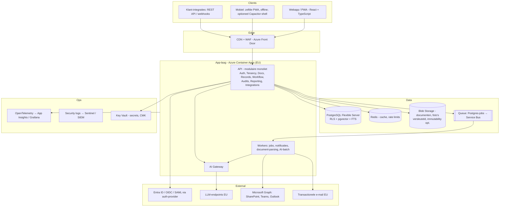

# 05 — Technische architectuur, platformkeuze & integraties

## 1. Architectuurprincipes

1. **Modulaire monoliet eerst**, met harde modulegrenzen (eigen schema/namespace, interne API's, events) zodat modules later losgeknipt kunnen worden.
2. **Tenant-isolatie op databaseniveau** (row-level security), niet alleen in applicatiecode.
3. **EU-data-residency** by default.
4. **Managed services** boven zelf beheren (klein team).
5. **Alles als code**: infrastructuur (Terraform/Bicep), configuratie, migraties.
6. **Observability en audit trail** vanaf dag 1.

## 2. Doelarchitectuur (fase 2–5)

## 3. Stackkeuze

| Laag | Beste optie | Alternatief | Waarom |
|---|---|---|---|
| Frontend | **React + TypeScript (Next.js of Vite SPA)**, component library (bijv. shadcn/Radix), TanStack Query | Angular, Vue | Grootste talentpool, rijk ecosysteem, goede PWA-ondersteuning |
| Offline/PWA | Service worker (Workbox), IndexedDB (Dexie), outbox-patroon voor sync | Native | Zie §6 |
| Backend | **TypeScript (NestJS) of .NET 8/9** — kies op basis van het team | Python (Django/FastAPI), Go | TS: één taal front/back, snel. .NET: sterk in Microsoft-georiënteerde enterprise-inkoop, uitstekende performance. Python alleen voor AI-workers indien nodig |
| Database | **PostgreSQL 16+** (managed) | SQL Server, MongoDB | RLS, JSONB voor configureerbare formulieren, pgvector, FTS, volwassen |
| Search | Postgres FTS + pgvector (fase 2–4) → OpenSearch/Azure AI Search (fase 5+, bij > 5–10 mln documenten of geavanceerde facetten) | Elastic vanaf dag 1 | Minder infra; isolatie via RLS |
| Queue/jobs | **Postgres-gebaseerde job queue** (pg-boss / Graphile Worker / Hangfire) → Azure Service Bus bij schaal | Kafka | Kafka is overkill tot honderden tenants met hoge event-volumes |
| Cache | Redis (managed) | — | Sessies, rate limiting, hot dashboards |
| Object storage | Azure Blob (versleuteld, per-tenant prefix, SAS-tokens kortlevend) | S3 | — |
| Auth | **Managed B2B-identity** (bijv. WorkOS, Auth0/Okta CIC, of Microsoft Entra External ID) of zelfgehost Keycloak | Zelfbouw | SSO (SAML/OIDC), SCIM, MFA als feature kopen = maanden besparing. Check EU-hosting van de provider |
| Hosting | **Azure (West Europe/NL + North Europe)** | AWS (eu-central-1/eu-west-1), GCP | Zie §4 |
| Compute | **Azure Container Apps** (fase 2–5) → AKS (fase 6, alleen indien nodig) | App Service, Kubernetes vanaf start | Serverless containers: weinig ops, schaalt naar nul voor non-prod |
| IaC | Terraform of Bicep | Handmatig | Reproduceerbaar, auditbaar (ISO 27001) |
| CI/CD | GitHub Actions: lint, tests, SAST, dependency scan, tenant-isolatietests, preview-omgevingen | Azure DevOps | — |
| Observability | OpenTelemetry → Application Insights of Grafana Cloud (EU) + Sentry | Datadog | Kosten vs. gemak |

## 4. Cloudkeuze

| Criterium | Azure | AWS | GCP | Supabase | Firebase |
|---|---|---|---|---|---|
| Fit met ICP (Microsoft 365-klanten, Entra ID) | ●●● | ●● | ● | ● | ● |
| EU-regio's / NL | ●●● (West Europe = NL) | ●●● (geen NL-regio; Frankfurt/Ierland) | ●●● (NL-regio) | ●● (EU-regio's via AWS) | ●● |
| LLM-toegang EU | ●●● (Azure AI Foundry, EU Data Zone) | ●●● (Bedrock EU) | ●●● (Vertex EU) | via externe API's | via Vertex |
| Managed Postgres + pgvector | ●●● | ●●● | ●●● | ●●● | ✗ (NoSQL) |
| Enterprise-inkoop (MACC/marketplace) | ●●● (Azure Marketplace telt mee voor klant-commitments) | ●●● | ●● | ● | ● |
| Snelheid prototype | ●● | ●● | ●● | ●●● | ●●● |
| Lock-in | Midden | Midden | Midden | Laag (Postgres) | **Hoog** |
| Kosten bij start | Midden | Midden | Midden | Laag | Laag |
| Compliance-certificeringen | ●●● | ●●● | ●●● | ●● (SOC 2) | ●●● |

**Advies:**
- **Prototype (fase 1):** Supabase (EU) is acceptabel voor snelheid, *mits* het datamodel puur Postgres blijft (RLS, SQL-migraties) zodat migratie naar Azure Postgres triviaal is.
- **MVP en verder:** **Azure**. Reden: de ICP en enterprise-kopers leven in Microsoft 365; Entra ID, Teams, SharePoint en Azure Marketplace verkorten verkoop en integratie.
- **Firebase: niet doen** (NoSQL past slecht bij relationeel compliance-datamodel, lastige tenant-isolatie en rapportage).
- **Kubernetes: niet vóór fase 6.** Container Apps biedt 90% van de voordelen met 10% van het beheer.

## 5. Multi-tenancy

| Model | Isolatie | Kosten | Complexiteit | Schaal | Advies |
|---|---|---|---|---|---|
| Gedeelde DB, gedeeld schema, `tenant_id` + **RLS** | Goed (DB-afgedwongen) | Laagst | Laag | Tot duizenden tenants | **Standaard (pool)** |
| Schema per tenant | Beter | Midden | Hoog (migraties × N) | Honderden | Niet doen |
| Database per tenant | Sterkst | Hoog | Midden | Tientallen–honderden | **Enterprise-optie (silo)** vanaf fase 6, tegen meerprijs |
| Deployment per tenant | Volledig | Zeer hoog | Hoog | Enkele | Alleen voor zeer grote/overheidsklanten |

**Implementatie:**
- Elke tabel heeft `tenant_id`; RLS-policy `tenant_id = current_setting('app.tenant_id')`; applicatie zet de setting per transactie via middleware; DB-rol van de app is **geen** eigenaar (RLS niet te omzeilen).
- **Automatische isolatietests** in CI: voor elk endpoint een test dat tenant B geen data van tenant A ziet.
- Bestanden: per-tenant prefix + autorisatie via API; nooit publieke URL's.
- Vector-chunks en AI-logs dragen `tenant_id` en vallen onder dezelfde RLS.
- Encryptie: platform-sleutels standaard; **customer-managed keys** (CMK) als enterprise-optie.
- Noisy neighbour: rate limits per tenant, job-queues met fair scheduling.

## 6. Autorisatie: RBAC + ABAC

- **RBAC** voor rollen (§4 van [03](03-functioneel-ontwerp-ux.md)).
- **Scope/ABAC** voor: site/project, afdeling, gevoeligheidsniveau (bijv. `health_data`), eigenaarschap.
- Implementatie: policy-functie in de domeinlaag (bijv. Casbin/Cerbos/OPA of eigen policy-module) + RLS voor tenant. Geen autorisatie in de frontend vertrouwen.

## 7. Events & integratie-architectuur

- **Domein-events** (bijv. `incident.reported`, `capa.overdue`, `document.approved`) via een **transactional outbox** in Postgres → workers → notificaties, webhooks, zoekindex, AI-jobs.
- Dezelfde events vormen de basis voor **webhooks** naar klanten en voor de **audit trail**.

## 8. Webapp vs. PWA vs. React Native vs. Flutter vs. native

| Criterium | Responsive webapp | **PWA** | React Native | Flutter | Native iOS + Android |
|---|---|---|---|---|---|
| Offline formulieren | ✗ | ●●● (IndexedDB + SW) | ●●● | ●●● | ●●● |
| Camera / foto's | ●● (input capture) | ●●● | ●●● | ●●● | ●●● |
| Push-notificaties | ✗ | ●● (Android volledig; iOS ≥ 16.4 alleen na "zet op beginscherm") | ●●● | ●●● | ●●● |
| Achtergrondsync | ✗ | ● (beperkt op iOS) | ●●● | ●●● | ●●● |
| GPS, QR-scannen | ●● | ●●● | ●●● | ●●● | ●●● |
| Performance | ●● | ●● | ●●● | ●●● | ●●● |
| Codehergebruik met web | 100% | 100% | ~50–70% (logica) | Laag (Dart) | 0% |
| Ontwikkelkosten extra t.o.v. web | 0 | + 10–20% | + 40–70% | + 50–80% | + 100–150% |
| Onderhoud | Laag | Laag | Midden | Midden | Hoog |
| App Store-afhankelijkheid | Geen | Geen | Ja | Ja | Ja |
| MDM-distributie (Intune) bij enterprise | n.v.t. | ● | ●●● | ●●● | ●●● |
| Time-to-market | Snelst | Snel | Midden | Midden | Traag |

**Advies:**
1. **Fase 1–4: PWA** met offline-first voor de veldflows (melden, LMRA, inspectie, toolbox). Installeerbaar via "zet op beginscherm"; QR-code-onboarding.
2. **Fase 4–5 (indien klanten push op iOS of MDM-distributie eisen): Capacitor-shell** rond dezelfde codebase → App Store/Play Store/Intune, native push, betere camera/achtergrond. Meerkost: ~4–8 weken.
3. **React Native alleen** als de veld-app een apart, zwaar product wordt (bijv. PTW met offline kaarten en NFC). Flutter en volledig native: niet aanbevolen (aparte skillset, dubbele kosten).

## 9. Schaalbaarheid, backups, disaster recovery

| Onderwerp | Fase 2–4 | Fase 5–6 |
|---|---|---|
| Database | 1 primair + HA-replica (zone-redundant), read-replica voor rapportages | Partitionering op `tenant_id`/tijd; silo-DB's voor enterprise; Citus indien nodig |
| Backups | PITR 35 dagen + dagelijkse geo-redundante backup; maandelijkse restore-test | Idem + immutable backups (ransomware) |
| RPO / RTO | RPO ≤ 15 min, RTO ≤ 4 uur | RPO ≤ 5 min, RTO ≤ 1 uur (secundaire regio warm standby) |
| SLA aan klant | 99,5% | 99,9% (enterprise) |
| Bestanden | Geo-redundante opslag (GRS), soft delete 30 dagen | + versie-immutability |
| Capaciteit | Tot ~300 tenants / 100k gebruikers zonder herarchitectuur | Horizontaal schalen app; DB-sharding per regio |

## 10. Cloudkosten (indicatief, per maand)

| Fase | Tenants | Infra (excl. AI) | AI | Tooling (auth, monitoring, e-mail, CI) | Totaal |
|---|---|---|---|---|---|
| Prototype | 0–3 | € 100–300 | € 50 | € 100 | **€ 250–450** |
| MVP/pilot | 5–20 | € 800–1.500 | € 200–400 | € 400–800 | **€ 1,4–2,7k** |
| Launch | 50–100 | € 2–4k | € 0,8–2k | € 1–2k | **€ 4–8k** |
| Scale | 300–500 | € 8–15k | € 4–10k | € 3–6k | **€ 15–31k** |

Bij ACV € 10k en 400 tenants (€ 4 mln ARR) ≈ 6–9% van omzet → past binnen een bruto marge van 75–82%.

## 11. Integratiestrategie

| Integratie | Waarde voor klant | Complexiteit | Fase | Aanpak |
|---|---|---|---|---|
| **Entra ID SSO (OIDC/SAML)** | Zeer hoog (IT-eis) | Laag (via auth-provider) | MVP | Standaard in Professional+ |
| **SCIM provisioning** | Hoog (> 200 FTE) | Laag–midden | 3–4 | Via auth-provider |
| **Outlook / e-mail** | Hoog (notificaties, acties via mail beantwoorden) | Laag | MVP (uitgaand), 4 (inbound) | — |
| **Teams** | Hoog (notificaties, "meld via Teams", approvals in Teams) | Midden | 3 | Teams-app + adaptive cards |
| **SharePoint** | Zeer hoog (documenten staan daar al) | Midden–hoog | 3 | Lezen + indexeren (Graph API), "SharePoint blijft bron" óf migratie; tweerichtingssync bewust vermijden |
| **Power BI** | Hoog (management, enterprise) | Midden | 4 | OData/REST-feed of geplande export naar klant-datalake |
| **Open REST API + webhooks** | Hoog (alle integraties van de klant) | Midden | 3 (read) / 4 (write) | OpenAPI 3.1, API-keys per tenant, rate limits |
| **HR-systemen** (AFAS, Visma/Youforce, Nmbrs, SAP SuccessFactors, Workday) | Midden–hoog (medewerkers, afdelingen, in/uit dienst) | Midden per connector | 4–5 | Eerst SCIM/CSV; daarna connectors voor top-2 in ICP (in NL vaak AFAS) — of via iPaaS (Make/Power Automate) |
| **SAP (EHS, PM, MM)** | Hoog bij enterprise | Hoog | 6 | Alleen met betalende enterprise-klant; via SAP BTP/OData/iPaaS |
| **Power Automate / Make / Zapier** | Midden | Laag | 4 | Connector geeft "integratie-moat" goedkoop |
| Wet- en regelgevingscontent | Midden | Laag (partner) | 4–5 | Partnerschap met contentleverancier |
