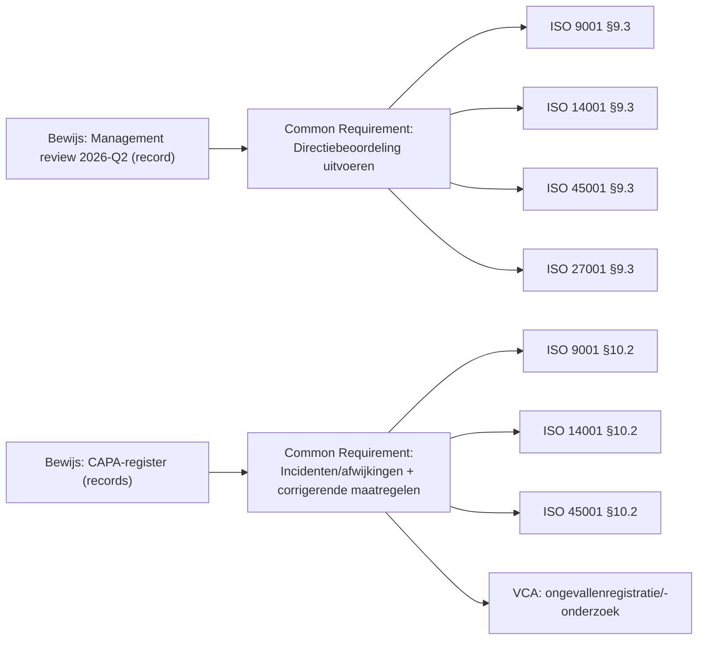
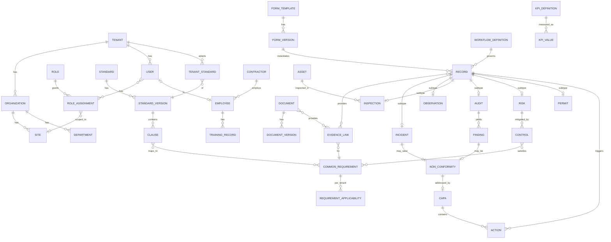

# 07 — Datamodel & ISO-integratie

## 1. ISO-integratie: één model, meerdere normen

### Het principe

ISO 9001, 14001, 45001 en 27001 volgen allemaal de **Harmonized Structure** (voorheen Annex SL): hoofdstukken 4–10 (Context, Leiderschap, Planning, Ondersteuning, Uitvoering, Evaluatie, Verbetering) met grotendeels identieke kernteksten. Daardoor is ~30–50% van de eisen gemeenschappelijk.

**Ontwerpkeuze:** een **gemeenschappelijke eisenlaag** ("Common Requirement") waaraan normspecifieke clausules worden gekoppeld. Bewijs (documenten, records) koppel je aan de *eis*, niet aan elke norm afzonderlijk. Zo telt één management review voor alle normen.

### Ontwerpregels

| Regel | Toelichting |
|---|---|
| Normen zijn **data, geen code** | Nieuwe norm (ISO 50001, CO2-Prestatieladder, NEN 7510, HKZ, ISO 22000) = content-import, geen release |
| **Normversies** | `Standard` + `StandardVersion` (bijv. ISO 9001:2015 → herziening verwacht rond 2026; ISO 14001 idem). Mapping oude ↔ nieuwe clausules voor transitie-ondersteuning — een concreet verkoopargument tijdens normrevisies |
| **Copyright** | Sla clausulenummer, titel, eigen parafrase, controlevragen en bewijs-typen op. **Geen** letterlijke normtekst tenzij gelicentieerd (NEN/ISO); klant kan eigen exemplaar uploaden (privé voor tenant) |
| Klant-specifieke eisen | Tenant kan eigen eisen toevoegen (klanteisen, wetgeving, interne beleidsregels) in dezelfde structuur |
| Toepasbaarheid | Per clausule: van toepassing / niet van toepassing + motivatie (vereist voor bijv. ISO 9001 §4.3 en ISO 27001 SoA) |

## 2. Conceptueel datamodel

### Kern (ER-diagram)

### Entiteiten (selectie, met kernattributen)

| Entiteit | Kernattributen | Opmerkingen |
|---|---|---|
| Tenant | id, naam, regio, plan, instellingen (AI aan/uit, retentie) | Isolatiegrens |
| Organization | tenant_id, naam, KvK, parent_id | Meerdere juridische entiteiten per tenant |
| Site | org_id, type (vestiging/project/klantlocatie), adres, geo, start/einddatum | Projecten = tijdelijke sites |
| Department | org_id, parent_id, naam | — |
| User | identiteit (IdP-subject), e-mail (optioneel), taal, licentietype (volledig/veld) | Veld-users zonder e-mail |
| Employee | personeelsnr., functie, afdeling, contractor_id?, user_id? | Mens ≠ account (niet iedereen logt in) |
| Role / RoleAssignment | rol, scope (tenant/org/site/afdeling) | RBAC + scope |
| Standard / StandardVersion / Clause | code, versie, nummer, titel, parafrase, controlevragen, bewijs-typen | Globale content (niet per tenant) + tenant-uitbreidingen |
| CommonRequirement | omschrijving, categorie (HS-hoofdstuk), mapping naar clausules | Kern van integratie |
| RequirementApplicability | tenant, eis, van toepassing?, motivatie, eigenaar, status | Basis van compliance-score |
| Document / DocumentVersion | type, eigenaar, status, versie, goedkeuringen, reviewdatum, bestand, hash | Versie immutable na goedkeuring |
| **Record** (supertype) | form_version_id, type, status, site, melder, datum, `data` (JSONB), gevoeligheid | **Generiek recordmodel**: incident, observatie, inspectie, LMRA, toolbox, TRA = Record met eigen formulier + workflow |
| Incident / Observation / … | Typespecifieke gestructureerde velden (ernst, letsel, milieu-impact) | Alleen velden die rapportage/KPI nodig heeft gestructureerd; rest JSONB |
| Audit / Finding | scope (normen, clausules, sites), auditor, type bevinding | — |
| NonConformity / CAPA | bron, oorzaakanalyse, maatregelen, effectiviteitscontrole | — |
| Action | bron (polymorf), eigenaar, termijn, status, bewijs | Eén actiemodel voor alles |
| Risk / Control | context, gevaar/aspect, kans, effect, score (methode), maatregelen | Methode configureerbaar (5×5, Fine & Kinney) |
| EvidenceLink | requirement_id, bron (document/record/control), geldig tot | Polymorf; bepaalt "actueel bewijs" |
| FormTemplate / FormVersion | JSON-schema + UI-schema, versie | Records verwijzen naar exacte versie |
| WorkflowDefinition | statussen, transities, guards, rollen, SLA's | Declaratief (JSON) |
| Contractor, TrainingRecord, Asset, Permit | — | Fase 4–6 |
| KPI_Definition / KPI_Value | formule, bron, periode, site | Deterministisch berekend |
| AuditLogEntry | actor, actie, object, oud/nieuw, tijd, hash-prev | Append-only |
| AIInteraction | use-case, model, bronnen, uitkomst, gebruikersbeslissing | Zie [04](04-ai-architectuur.md) |

### Technische ontwerpkeuzes datamodel

| Keuze | Beste optie | Alternatief | Afweging |
|---|---|---|---|
| Configureerbare formulieren | **Hybride:** gestructureerde kolommen voor rapportage-kritische velden + JSONB voor configureerbare velden, met JSON-schema-validatie | EAV-model; volledig JSONB | EAV is traag en complex; volledig JSONB maakt KPI's/rapportage lastig |
| Records | **Supertype `record` + subtype-tabellen** | Aparte tabellen zonder supertype | Supertype = één actie-, bewijs-, zoek- en audit-trail-mechanisme |
| Historie | Audit log + versiebeheer op documenten/formulieren; temporele tabellen voor clausule-toepasbaarheid | Event sourcing | Event sourcing is te complex voor dit team; audit log volstaat voor ISO/AVG |
| ID's | UUIDv7 (sorteerbaar), plus mensleesbare nummers per tenant (INC-2026-0042) | Auto-increment | — |
| Meertaligheid | Vertaaltabellen voor content (normen, templates); gebruikersinvoer blijft in brontaal + optionele AI-vertaling | — | — |
