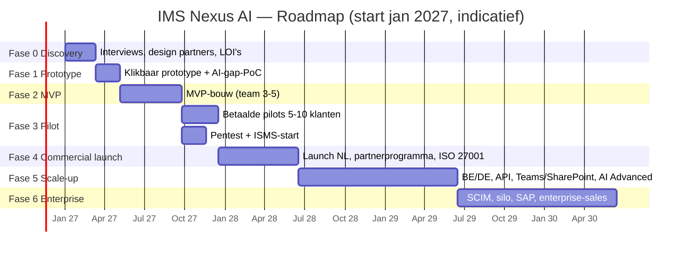

# 10 — MVP, Roadmap & Validatieplan

## 1. MVP-scope

**Doel:** zo snel mogelijk aantonen dat organisaties in ICP A **betalen** voor "audit-ready met één registratie + veldmeldingen + AI-auditvoorbereiding".

### Must-have (MVP, fase 2)

| # | Functionaliteit | Waarom onmisbaar |
|---|---|---|
| 1 | Multi-tenant basis: organisatie, sites/projecten, afdelingen, gebruikers, 6 vaste rollen | Fundament |
| 2 | Login: e-mail + MFA, **Entra ID SSO**, veld-login zonder e-mail (QR/pincode) | IT-eis + veldadoptie |
| 3 | Normkader ISO 9001/14001/45001 (HS) + VCA-structuur, common requirements, toepasbaarheid | Kernbelofte |
| 4 | Documentbeheer: upload, versies, goedkeuring, reviewdatum, koppeling aan eisen | Bewijs |
| 5 | **AI-documentimport & gap-analyse** (bulk-upload bestaand handboek → mapping + gaps met bronnen) | Onboarding in dagen + "wow" in de sales-demo |
| 6 | Meldingen (incident, bijna-ongeval, observatie, klacht) via PWA, **offline**, foto, spraak, AI-classificatie | Veld + data |
| 7 | Acties & CAPA met termijnen, herinneringen, effectiviteitscontrole | Opvolging |
| 8 | Inspecties & LMRA met 10–15 standaardtemplates (VCA-checklist, werkplekinspectie) + eenvoudige formulierbouwer | Veld |
| 9 | Interne audits: planning, checklist per clausule, bevindingen → CAPA, PDF-rapport | Audit-ready |
| 10 | **Audit-readiness-overzicht + AI-auditdossier per norm** | Kernbelofte |
| 11 | Dashboards (QHSE, directie, leidinggevende) + basis-KPI's + Excel/PDF-export | Waarde zichtbaar |
| 12 | Notificaties (e-mail + digest), audit trail, tenant-export | Basis/compliance |
| 13 | DPA, AV, privacy-/AI-factsheets, AVG-functionaliteit (gezondheidsvelden afgeschermd, retentie) | Verkoopbaar |

### Should-have (fase 3 / pilot)

Management review-generator (§9.3) · RAG-zoeken/Q&A met citaten · CAPA-suggesties · risicoregister + TRA · toolbox-registratie (QR-aanwezigheid) · Teams-notificaties · SharePoint-indexering (read) · NL/EN + veld-UI in PL/TR/RO · partner-tenant (adviseur ziet meerdere klanten).

### Later (fase 4–6)

SCIM · REST API write + webhooks · Power BI-connector · AI Advanced (agents, bulkanalyses) · training/certificaatregistratie · contractors-portaal · PTW · assets & keuringen · wet- en regelgevingsregister (partnercontent) · Capacitor-app (App Store/Intune) · ISO 27001-normkader als product · DE/FR · enterprise silo/CMK · SAP/HR-connectors · visuele workflowdesigner.

### Expliciet NIET bouwen (ook niet "even snel")

| Niet bouwen | Reden |
|---|---|
| Native iOS/Android-apps | PWA volstaat; 2× kosten |
| Eigen LMS / e-learning | Integreren |
| Eigen BI-/rapportage-designer | Export + Power BI |
| Visuele workflowdesigner (in MVP) | Templates + configuratie volstaan |
| AI-beoordeling van individuele medewerkers | AI Act high-risk, OR, AVG |
| Eigen LLM / fine-tuning | Geen meerwaarde, wel risico |
| Maatwerk per klant in de codebase | Vernietigt schaalbaarheid; alleen configuratie |
| Chemicaliënbeheer / SDS-database | Niche met sterke specialisten |
| ESG/CSRD-rapportagemodule | Andere koper, bewegend wetgevingsdoel; later evalueren |
| Microservices / Kubernetes | Overkill |

## 2. Roadmap

| Fase | Duur | Doel | Belangrijkste deliverables | Team | Budget (indicatief) | **Stage-gate (exit-criteria)** |
|---|---|---|---|---|---|---|
| **0 Discovery** | 8–10 wk | Probleem & betaalbereidheid valideren | 25+ interviews, ICP-bevestiging, 3–5 design partners met LOI, pricing-test, concurrentiedemo's, PRD v1 | Founder(s) + part-time designer | € 15–40k | ≥ 3 LOI's met indicatieve prijs ≥ € 5k/jaar; top-3 pijnpunten bevestigd |
| **1 Prototype** | 6–8 wk | Oplossing valideren | Figma-prototype (veld + kantoor), AI-gap-analyse-PoC op echte documenten van design partners, architectuurbeslissingen (ADR's), CTO/technisch cofounder aan boord | Founder + 1–2 dev + designer | € 40–80k | Design partners: "dit zouden we gebruiken" (≥ 8/10 op relevantie); AI-gap-recall ≥ 70% op testset |
| **2 MVP** | 4–5 mnd | Werkend product | Must-have-scope, CI/CD, monitoring, DPA/AV, AI-evaluatieset | 3–5 FTE | € 250–400k | Design partners live; ≥ 3 betalen (ook als korting); kritieke flows werken offline |
| **3 Pilot** | 3 mnd | Waarde en adoptie bewijzen | 5–10 betaalde pilots (60–90 dagen), should-haves, pentest, case studies | 4–6 FTE | € 150–250k | ≥ 5 betalende klanten ≥ € 5k ACV; WAU kerngebruikers ≥ 60%; ≥ 1 externe audit doorstaan met het product; NPS ≥ 30 |
| **4 Commercial launch** | 6 mnd | Herhaalbare verkoop NL | Website, partnerprogramma (3–5 bureaus), pricing live, ISO 27001-certificering gestart/behaald, CS-processen | 6–10 FTE | € 0,5–0,8 mln | ≥ 15–25 klanten, ≥ € 150k ARR, logo-churn < 10%, ≥ 25% nieuwe deals via partners → **seed-ronde** |
| **5 Scale-up** | 12 mnd | Groei + tweede markt | BE (NL-talig eerst), DE-pilot, API/webhooks, Teams/SharePoint, AI Advanced, Capacitor-app indien nodig | 12–20 FTE | € 1,5–2,5 mln | ARR ≥ € 1 mln, NRR ≥ 105%, CAC-payback < 18 mnd |
| **6 Enterprise** | 12+ mnd | Hogere ACV | SCIM, silo/CMK, SLA 99,9%, SAP/HR-connectors, enterprise-sales, ISO 42001 | 20–35 FTE | € 3+ mln | ≥ 5 enterprise-klanten ≥ € 50k ACV → Series A |

## 3. Validatieplan

### 3.1 Klantinterviews (fase 0)

| Onderdeel | Aanpak |
|---|---|
| Doelgroep | 25–40 gesprekken: 15 QHSE-managers ICP A, 5 ICP B, 5 directeuren, 5 adviseurs/consultants, 3–5 lead-auditors van certificatie-instellingen |
| Methode | Probleeminterviews (*The Mom Test*): vraag naar afgelopen audit, laatste incident, tijdsbesteding, huidige uitgaven — niet naar meningen over het idee |
| Kernvragen | "Hoeveel dagen kostte de laatste auditvoorbereiding?" · "Wat betaal je nu aan consultants/software?" · "Wat ging er mis bij de laatste audit?" · "Hoe komen meldingen uit het veld nu binnen?" · "Wie beslist over aanschaf en met welk budget?" |
| Output | Pijnmatrix (frequentie × intensiteit), budgetdata, beslisproces, top-10 functies, kwalificatie design partners |
| Kill-criterium | < 30% van ICP A noemt auditvoorbereiding/dubbele registratie spontaan als top-3 pijn |

### 3.2 Design partners

- 3–5 organisaties (mix: 2× bouw/installatie, 1× industrieel onderhoud, 1× productie, 1× adviesbureau).
- Afspraak: tweewekelijkse sessie, documenten beschikbaar voor AI-PoC (met verwerkersovereenkomst!), referentie bij succes.
- Tegenprestatie: 50% korting jaar 1 + prijsgarantie 24 mnd — **niet gratis** (gratis = geen echte validatie).

### 3.3 Prototype-tests (fase 1)

| Test | Methode | Succescriterium |
|---|---|---|
| Veldmelding | 10 veldmedewerkers, taak-gebaseerd, op eigen telefoon, buiten | Mediaan < 60 sec, ≥ 9/10 voltooit zonder hulp |
| Audit-readiness-overzicht | 5 QHSE-managers, think-aloud | Begrijpen status per clausule zonder uitleg |
| AI-gap-analyse | Echte handboeken van 3–5 design partners vs. expertbeoordeling | Recall ≥ 70%, precisie ≥ 70%, 0 verzonnen bronnen |

### 3.4 Pilots (fase 3)

- 60–90 dagen, **betaald** (bijv. € 1.500–3.000 pilotfee, verrekenbaar met jaarcontract).
- Vooraf vastgelegde succescriteria met klant: bijv. "interne audit volledig in IMS Nexus", "≥ 50 meldingen uit veld", "auditvoorbereiding ≤ 50% van vorig jaar".
- Conversiedoel pilot → jaarcontract: ≥ 60%.

### 3.5 Willingness-to-pay & pricing-tests

| Methode | Wanneer | Doel |
|---|---|---|
| Van Westendorp (4 prijsvragen) | Fase 0 interviews | Acceptabele bandbreedte per FTE-segment |
| Anker op huidige kosten (consultancy + software + interne uren) | Fase 0–1 | Business case per klant |
| Echte offertes aan design partners (3 varianten: A/B/C uit [08](08-pricing-businessmodel.md)) | Fase 1–2 | Voorkeur en conversie |
| Tier-test op website (fake door / "vraag offerte") | Fase 4 | Tier-mix |
| Prijsverhoging voor nieuwe cohorten (+15–20%) | Fase 4–5 | Elasticiteit |

## 4. Implementatieplan (eerste 180 dagen)

| Week | Activiteit | Eigenaar |
|---|---|---|
| 1–2 | Interviewscript, doelgroeplijst (100 namen uit netwerk + LinkedIn + VCA/ISO-netwerken), BV/juridische basis | Founder |
| 1–10 | 25–40 interviews; wekelijks synthese | Founder |
| 3–6 | Zoektocht technisch cofounder/CTO of senior lead dev; architectuur-ADR's | Founder |
| 6–10 | Design partners werven, LOI's, verwerkersovereenkomsten | Founder |
| 8–12 | Normontologie v1 (clausules, common requirements, bewijs-typen) — met ISO-expert; licentievraag NEN | Founder + domeinexpert |
| 10–18 | Prototype (Figma) + AI-gap-PoC; usability-tests | Designer + dev |
| 12 | **Go/no-go 1** (fase 0 stage-gate) | Founders |
| 16–18 | Pre-seed afronden (of bootstrap-keuze) | Founders |
| 18 | **Go/no-go 2** (fase 1 stage-gate), start MVP-bouw | Founders + CTO |
| 18–38 | MVP-sprints (2-weeks), design partners elke sprint review | Team |
