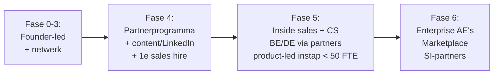

# 11 — Go-to-market, Risico's, Investeringscase & Eindadvies

## 1. Go-to-market

### 1.1 Kanalen vergeleken

| Kanaal | CAC | Schaalbaarheid | Time-to-revenue | Fit ICP A | Fase | Oordeel |
|---|---|---|---|---|---|---|
| **Founder-led sales** | Laag (€ 4–6k) | Laag | Snel | ●●● | 0–4 | **Start hier.** Founder verkoopt de eerste 20–30 klanten zelf — essentieel voor productinzicht |
| **LinkedIn (founder-content + gerichte outreach)** | Laag–midden | Midden | Midden | ●●● | 1+ | Wekelijkse content over audits/VCA/ISO-praktijk; "audit-readiness-scan" als lead magnet |
| **ISO-/QHSE-adviesbureaus (partners)** | Midden (commissie) | **Hoog** | Midden | ●●● | 3+ | **Belangrijkste schaalkanaal.** Adviseurs bedienen 10–40 klanten; product maakt hun werk efficiënter |
| Certificatie-instellingen (netwerk, events) | Laag | Midden | Traag | ●● | 4+ | Onafhankelijkheid: zij mogen geen product aanbevelen; wel kennissessies/webinars, aanwezigheid op events |
| HSE/QHSE-netwerken & branche (bijv. NVVK, branche-organisaties bouw/installatie, VCA-gerelateerde netwerken) | Laag | Midden | Midden | ●●● | 2+ | Kennissessies, sprekersplekken, whitepapers |
| Resellers (IT-/M365-partners) | Midden | Midden | Traag | ●● | 5+ | Azure Marketplace + M365-partners voor enterprise |
| Technologiepartnerships (HR-systemen, inspectie-apps) | Laag | Midden | Traag | ●● | 5+ | Integratie-marketplaces |
| Enterprise direct sales | Hoog (€ 40–80k) | Midden | Zeer traag | ● | 6 | Pas met ISO 27001, SSO/SCIM, referenties |
| Paid search / ads | Hoog in niche | Laag | Snel | ● | 4+ (beperkt) | Alleen op koopintentie-termen ("ISO 45001 software") |

### 1.2 Motion per fase

### 1.3 Verkoopproces mid-market (doel: 45–75 dagen)

1. **Trigger** (nieuwe norm, audit gepland, nieuwe QHSE-manager, incident) →
2. **Gratis audit-readiness-scan**: klant uploadt (onder DPA) handboek → AI-gap-rapport in 48 uur →
3. **Demo op eigen data** (gap-rapport + veldmelding live) →
4. **Business case** (consultancy- en tijdsbesparing) + offerte →
5. **Betaalde pilot of direct jaarcontract** met implementatiepakket →
6. **Onboarding** 2–4 weken → eerste interne audit in het systeem → referentie.

### 1.4 Positionering & messaging

| Doelgroep | Boodschap |
|---|---|
| QHSE-manager | "Stop met dubbel registreren. Eén melding telt voor ISO 9001, 14001, 45001 én VCA — en je auditdossier bouwt zichzelf." |
| Directie | "Certificaten behouden en tenders winnen met de helft van de administratie — en altijd weten waar je staat." |
| Veld | "Melden in een minuut, ook zonder bereik." |
| IT/privacy | "EU-gehost, Entra ID SSO, ISO 27001-traject, AI zonder training op jullie data." |
| Adviseur | "Bedien al je klanten vanuit één omgeving en lever meer waarde per uur." |

## 2. Risicoregister

| # | Categorie | Risico | K | I | Score | Mitigatie | Eigenaar |
|---|---|---|---|---|---|---|---|
| R1 | Product | Scope creep / te breed | 4 | 5 | 20 | Stage-gates, "niet bouwen"-lijst, module-entreecriterium | CEO/PO |
| R2 | Markt | Verkoopcycli lang, lage urgentie buiten auditperiode | 4 | 4 | 16 | Trigger-gebaseerde prospecting, gratis scan, partners | CEO |
| R3 | Concurrentie | Gevestigde spelers/Copilot leveren vergelijkbare AI | 4 | 4 | 16 | Moat in datamodel, workflow, content, kanaal | CEO/CTO |
| R4 | AI | Hallucinatie leidt tot fout auditadvies | 3 | 5 | 15 | Bronverplichting, citaatverificatie, HITL, evaluatieset, aansprakelijkheidsbeperking in AV | CTO |
| R5 | Juridisch | ISO-copyright | 4 | 3 | 12 | Eigen parafrases, licentie NEN/ISO onderzoeken | CEO |
| R6 | Privacy | Gezondheidsdata / OR-instemming vertraagt deals | 3 | 4 | 12 | OR-pakket, DPIA-template, privacy by default | CEO/DPO |
| R7 | Security | Datalek / cross-tenant-lek | 2 | 5 | 10 | RLS, tests, pentests, ISO 27001, cyberverzekering | CTO |
| R8 | Team | Geen sterke technische lead; afhankelijkheid van freelancers | 3 | 5 | 15 | CTO/cofounder vóór MVP, kennis in eigen team, documentatie (ADR's) | CEO |
| R9 | Financieel | Seed-ronde lukt niet op tijd | 3 | 5 | 15 | Fundraising vanaf maand 9, plan B (afschalen, consultancy) | CEO/CFO |
| R10 | Operationeel | Implementaties/maatwerk eten capaciteit | 4 | 3 | 12 | Gestandaardiseerde pakketten, partners doen implementatie | COO/CS |
| R11 | Regelgeving | AI Act/NIS2-eisen veranderen | 3 | 2 | 6 | Volgen via jurist, conservatieve AI-scope | DPO |
| R12 | Leverancier | LLM-leverancier verandert prijs/voorwaarden | 3 | 2 | 6 | Model-agnostische gateway, 2 leveranciers | CTO |
| R13 | Normen | ISO 9001/14001-revisie wijzigt structuur | 4 | 2 | 8 | Versioneerbaar normkader; revisie = verkoopkans (transitietool) | PO |

## 3. Investeerbaarheid

### 3.1 Beoordeling

| Criterium | Oordeel | Toelichting |
|---|---|---|
| Marktgrootte | ●● (NL) / ●●● (EU) | NL: € 75–100 mln SAM → mooi bedrijf, geen unicorn. EU-mid-market: € 0,8–1 mld SAM → venture-case mogelijk |
| Recurring revenue | ●●● | Certificering is jaarlijks terugkerend; jaarcontracten; lage churn bij embedded IMS |
| Switching costs | ●●● (na 12 mnd) | Historie van incidenten, audits, CAPA's en documentversies is lastig te migreren; auditors kennen het systeem |
| Integratie-moat | ●● | M365/Entra/Teams/HR-koppelingen: matig, groeit |
| Data-moat | ●● | Geaggregeerde benchmarks (bijv. meldingsfrequentie per sector) en AI-evaluatiedata — alleen met contractuele basis; beperkt in jaren 1–3 |
| AI-moat | ● | Foundation models zijn commodity; voorsprong 12–24 maanden |
| Content-/domein-moat | ●● | Normontologie, cross-mapping, VCA-/sectortemplates, NL-regelgeving |
| Kanaal-moat | ●●● (potentieel) | Een netwerk van adviesbureaus dat op IMS Nexus standaardiseert is moeilijk te kopiëren |
| Internationale schaalbaarheid | ●● | ISO is universeel; VCA/wetgeving/talen lokaal → per land 6–12 mnd lokalisatie + partner |
| Exit-opties | ●●● | Actieve consolidatie: Wolters Kluwer (Enablon, Quentic), Fortive (Intelex), Ideagen (PE-backed, buy-and-build), EcoOnline (PE), certificatie-/inspectiebedrijven, ERP-spelers. Strategische exit bij € 5–20 mln ARR realistisch (indicatieve multiples vertical SaaS 2026: 4–8× ARR, afhankelijk van groei en marge) |

### 3.2 Investment thesis (concept)

> IMS Nexus AI is het AI-native geïntegreerde managementsysteem voor het Europese mid-market. Het vervangt Excel, SharePoint-mappen en een deel van de consultancy door één datamodel waarin elke veldmelding, audit en actie automatisch bewijs vormt voor meerdere ISO-normen en VCA. Begonnen in de Benelux bij bouw, installatie en industriële dienstverlening — een markt met jaarlijks terugkerende certificeringsdruk en hoge veldcomplexiteit — schaalt het via adviesbureaus naar DACH en de Nordics. Tegenover enterprise-suites wint het op implementatietijd (weken i.p.v. maanden) en prijs; tegenover point solutions op integratie en audit-readiness.

### 3.3 Wat een investeerder wil zien vóór seed

| Metric | Drempel |
|---|---|
| Betalende klanten | ≥ 15 |
| ARR | ≥ € 120–200k |
| Gem. ACV | ≥ € 7,5k |
| Logo-churn (annualized) | < 10% |
| Pilot → betaald | ≥ 60% |
| Partnerkanaal | ≥ 3 actieve partners, ≥ 1 deal/maand via partners |
| Team | Domeinexpert + sterke technische lead in founding team |
| Productgebruik | WAU kerngebruikers ≥ 60%; meldingen/100 veldmedewerkers/maand groeiend |

## 4. Eindadvies

### Doen
1. **Kies de wedge:** Benelux, 50–500 FTE, bouw/installatie/industriële dienstverlening, ISO 9001/14001/45001 + VCA.
2. **Positioneer op uitkomst** (audit-ready, één registratie, veldadoptie), niet op "AI".
3. **Bouw het system of record** met een breed datamodel maar smalle UI; AI adviserend met bronnen.
4. **Architectuur:** modulaire monoliet, PostgreSQL + RLS + pgvector, Azure EU, PWA, managed auth met Entra ID SSO.
5. **Pricing:** platformfee + per medewerker, gratis veld-gebruikers, betaalde implementatie.
6. **GTM:** founder-led → adviesbureaus als kanaal → BE/DE.
7. **Financiering:** scenario 2 (klein team), pre-seed € 0,75–1,0 mln, seed na bewezen traction.
8. **Compliance als verkoopargument:** DPA, EU-hosting, AI-factsheets vanaf dag 1; ISO 27001 binnen 24 maanden.

### Niet doen
- 30 modules tegelijk bouwen.
- Enterprise, internationaal en ISO 27001-markt in jaar 1.
- AI die mensen beoordeelt.
- Native apps, microservices, Kubernetes, eigen LLM.
- Gratis pilots zonder succescriteria.

### Eerstvolgende 3 stappen (deze maand)
1. Interviewlijst van 50 QHSE-managers in de ICP + interviewscript (*Mom Test*).
2. Normontologie v1 in een spreadsheet: HS-hoofdstukken 4–10 × 9001/14001/45001/VCA → common requirements + bewijs-typen.
3. Besluit over technisch partnerschap (cofounder/CTO vs. freelance-team) — dit bepaalt scenario en budget.

## 5. Open vragen aan de founder (niet blokkerend)

| Vraag | Waarom relevant |
|---|---|
| Wat is jouw achtergrond en netwerk (QHSE-consultant, QHSE-manager, ontwikkelaar)? | Bepaalt GTM, CAC en of een technische cofounder nodig is |
| Is de oorspronkelijke Product Vision / FDS beschikbaar? | Om dit document te verfijnen tot PRD v1 |
| Welk startkapitaal en welke ambitie (winstgevend bedrijf vs. VC-schaal)? | Kiest tussen scenario 1/2 en 3/4 |
| Zijn er al geïnteresseerde organisaties (potentiële design partners)? | Versnelt fase 0 |
| Startmarkt definitief NL/BE? | Taal, regelgeving, partners |
